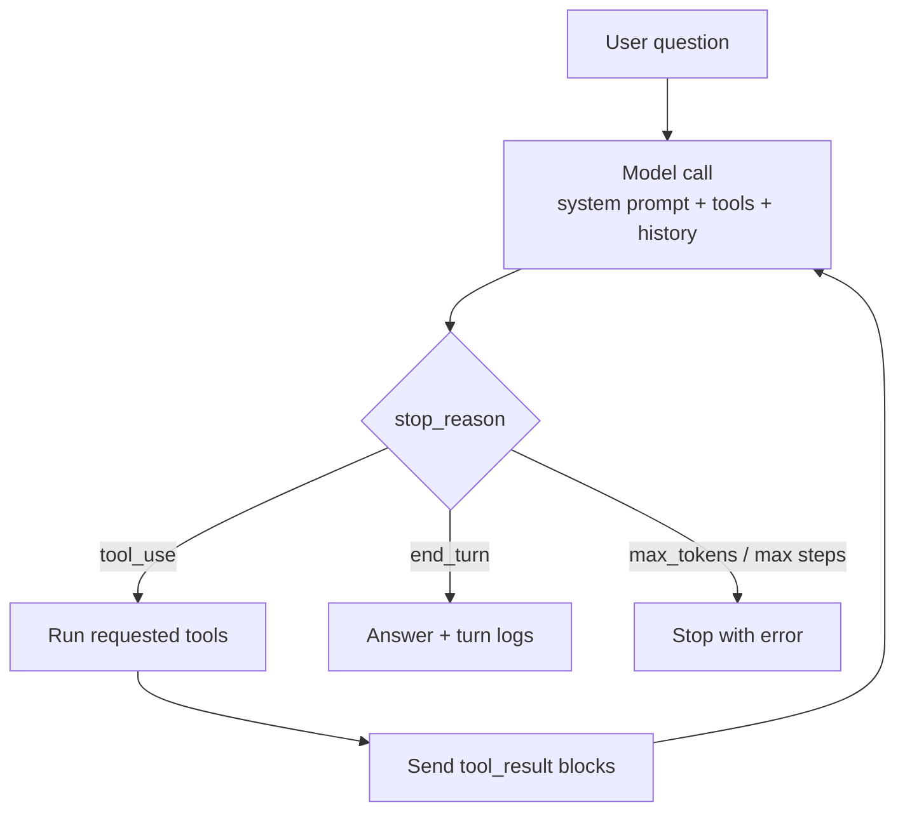

# Tool-Calling Agent (No Framework)

A tool-using AI agent built from scratch on the Anthropic Messages API, without any agent framework. It handles the full tool-use loop, sandboxed file access, per-turn cost logging and an automated eval.

## How it works

## What it does

| Tool | Purpose |
| --- | --- |
| `calculator` | Math expressions (via `numexpr`, not `eval()`) |
| `getTime` | Current time in any IANA timezone |
| `readFile` | Reads text files, sandboxed to `data/` (blocks path traversal) |
| `webSearch` | Web search with result size limits to control cost |

**Stack:** Python, Anthropic API, Streamlit · **Structure:** `core.py` (agent loop), `tools.py`, `logger.py`, `agent.py` (UI), `eval/`

## Results

**Model comparison** on a 15-question eval set (same settings):

| | Claude Haiku 4.5 | Claude Haiku 5.5 |
| --- | --- | --- |
| Score | 15/15 | 15/15 |
| Total cost | $0.0393 | $0.0052 |
| Follows prompt rules | Partly | Yes |

Both scored 15/15, but reading the answers showed Haiku 5.5 followed instructions better at ~7.5x lower cost. Keyword-based evals measure pass/fail, not quality.

**Tool description experiment:** weakening the `getTime` definition step by step showed that good names (`timezone`) carry as much information as descriptions, a vague tool costs extra turns when the model guesses wrong, and a tool with no description is ignored entirely.

## Key findings

- Turn count drives cost: every turn resends the full history (~1,100 tokens base).
- When search failed, the model fell back to outdated training data with confidence; the current date in the system prompt and instructive error messages fixed it.
- Limits on model input (file paths, result counts) must be enforced in code, not only in the prompt.

## Limitations

DuckDuckGo search is often rate-limited; the eval uses keyword checks and cannot judge answer quality.
